# End-to-end authentication walkthrough

This guide follows an authentication attempt from the first Sign in click through
login or account creation, session delivery, recovery, and logout. It describes
the implementation introduced through commit `0f0da1b` and links to the code that
owns each step. Read the [README](../README.md) for setup and configuration.

The React UI and Next.js backend for frontend (BFF) form one application. The
embedding host and the configured configuration and IAM REST APIs are integration
roles in this guide. Their implementation and deployment are managed independently.
The browser tests supply local fixtures for those interfaces.

## Reading the diagrams

| Participant | Responsibility |
| --- | --- |
| Embedding host | Open the iframe on a user action, correlate messages, and check the shared session |
| React iframe | Collect input, invoke native WebAuthn, display errors, and follow the authentication state |
| Next.js BFF | Validate requests, load policy, track attempts, call REST APIs, and deliver the session cookie |
| Configuration API | Return the registered client configuration and allowed parent origin |
| IAM | Verify credentials, factors, and WebAuthn responses, manage accounts, and sign user sessions |
| Context store | Persist BFF attempts, consumed launch state, and context locks |
| Browser and authenticator | Create passkeys or produce signed passkey assertions through native prompts |

In the diagrams, `C` means the BFF `contextId` and `G` means the internal
`gatewayContextId`. Browser endpoint labels below `/api/auth` sometimes omit that
prefix for readability. IAM operations run through the REST adapter.

| Value | Owner and lifetime | Purpose |
| --- | --- | --- |
| `clientId` | Registered client configuration | Public UUID used to retrieve the allowed parent origin and policy |
| `state` | Embedding host, one launch | Correlate iframe messages and prevent reuse of the same browser/client/state combination |
| `contextId` | BFF, one attempt | Opaque UUID that React sends with context operations |
| `gatewayContextId` | IAM, one attempt | Internal ID the BFF uses for IAM calls, stored only server-side |
| `challengeId` | IAM, one MFA challenge | Identify the active OTP challenge, stored only server-side |
| `completionId` | React, one enrollment choice | Recognize a recovery request after Add a Passkey or Skip for now |
| `session:${context.id}` | BFF, one attempt | Stable IAM session idempotency key for initial issuance and recovery |

The session JWT is delivered to the browser as an HttpOnly cookie. JSON responses
and browser messages carry completion status and correlation data. Public WebAuthn
options and credential responses travel through React during passkey operations.

## Start with the code entry points

| Code | What to follow |
| --- | --- |
| [page.tsx](../src/app/page.tsx) | Render `AuthExperience` at `/` |
| [providers.tsx](../src/app/providers.tsx) | Provide React Query with automatic query and mutation retries disabled |
| [auth-experience.tsx](../src/features/authentication-flow/auth-experience.tsx) | Coordinate initialization, login screens, passkeys, registration, and messages |
| [machine.ts](../src/features/authentication-flow/machine.ts) | XState transitions between login screens |
| [initialize-context.ts](../src/features/host-bridge/initialize-context.ts) | Bootstrap and validate the embedding handshake |
| [API routes](../src/app/api/auth) | Map browser HTTP requests to BFF operations |
| [http.ts](../src/server/http.ts) | Safe errors and locked context validation |
| [iam-client.ts](../src/server/infrastructure/iam-client.ts) | Translate BFF operations into authenticated REST requests |

The screens share the `/` entry page. The React state machine chooses identifier,
password, OTP, verification progress, passkey offer, or completion. Registration
uses its own component state inside `RegistrationExperience`.

## 1. Load the MFE after Sign in

The integration checks its existing session on page load and again when the user
chooses Sign in. A valid session lets it show the authenticated experience. A
signed-out user who clicks Sign in starts a fresh iframe launch.

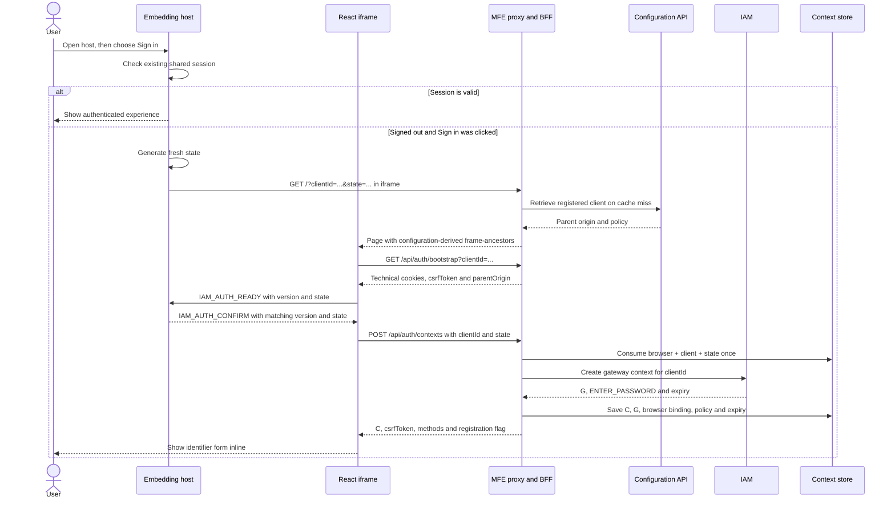

Follow [initialize-context.ts](../src/features/host-bridge/initialize-context.ts),
the [bootstrap route](../src/app/api/auth/bootstrap/route.ts), and the
[contexts route](../src/app/api/auth/contexts/route.ts) in that order.

1. The URL provides `clientId` and `state`. React requires an iframe and a state
   containing 16–128 allowed characters. Direct navigation displays the launch
   screen. The compact UI has one presentation mode.
2. [proxy.ts](../src/proxy.ts) retrieves the configured parent origin for `/` and
   applies the `frame-ancestors` policy through the shared
   [headers helper](../src/server/security/headers.ts). Unusable configuration
   produces `frame-ancestors 'none'`. Assets skip the configuration lookup.
3. Bootstrap validates configuration and establishes `iam_poc_browser` and
   `iam_poc_csrf`. Both are host-only cookies. The browser-binding cookie is
   HttpOnly. The CSRF token is also returned in JSON for subsequent POST headers.
4. React sends `IAM_AUTH_READY` to the exact registered parent origin. It waits up
   to ten seconds for `IAM_AUTH_CONFIRM`, checking origin, parent window, message
   version `1`, type, and the original `state`.
5. React posts `{ clientId, state }` with the CSRF header. The BFF consumes a replay
   key derived from browser binding, client ID, and state, then creates both IDs.
   It validates the IAM context response and saves stage `PASSWORD`.
6. Attempt expiry is the earlier of the configured context expiry and IAM expiry.
   React receives `contextId`, allowed authentication and MFA methods, the
   registration flag, state, parent origin, and expiry.

The registered `clientId` is public. The framing and message checks establish the
browser integration boundary. Backend operations still require request validation,
browser binding, allowed stages, and IAM decisions.

The [configuration adapter](../src/server/clients/configuration.ts) caches validated
configuration for up to 30 seconds. It checks the client ID, enabled and inline
flags, `SHARED_COOKIE` protocol, exact parent origin, policy, and shared-domain
compatibility. Refresh failure after expiry fails the request. Later context
operations check the configured parent origin and policy version again.

## 2. Authenticate the BFF's REST calls

The browser and BFF communicate on the MFE origin. The BFF calls configured REST
services using subscriber credentials held in server-side configuration.

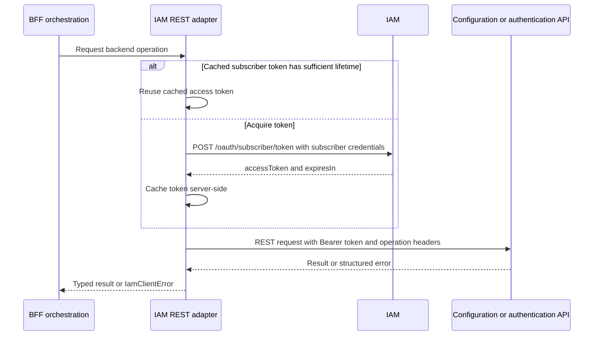

[iam-client.ts](../src/server/infrastructure/iam-client.ts) obtains the subscriber
token, reuses it while more than ten seconds remain, and includes it in backend
requests. POST operations receive operation-specific idempotency keys. Requests
use `cache: no-store` and a ten-second timeout. A backend `401` clears the cached
service token for the next request. The configured IAM issuer and JWKS settings
apply to user-session verification separately.

### Checks shared by browser requests

Every BFF POST validates the exact MFE `Origin` against `IDENTITY_ORIGIN` and
compares the `x-csrf-token` header with the CSRF cookie using a timing-safe
comparison. The browser sends its MFE cookies with these same-origin requests.
The embedding parent's origin is checked separately through configuration and
the browser-message protocol.

For an existing attempt, `withContext()` acquires a context lock before loading
and validating the record. It checks absolute expiry, the original browser-cookie
hash, the currently configured parent origin and policy version, and the stages
allowed by the operation. The lock encloses the IAM calls and context updates.
Rejected requests return a safe error and stop before the protected work.

[context-store.ts](../src/server/auth/context-store.ts) supports memory storage for
one development process and requires Redis for production authentication. Redis
stores context records with their remaining absolute lifetime and atomically
consumes launch state. A context lock uses a random owner, a 90-second lease, and
owner-checked release. A concurrent request receives `CONTEXT_BUSY`. Redis failures
propagate to the request. Memory state is lost on restart and is isolated to its
process. The UI machine and the BFF stage have separate purposes, so browser state
alone cannot advance a server operation.

## 3. Identify the account

Submitting the identifier calls `/api/auth/registration/identify` even for an
existing user. IAM determines which screen follows.

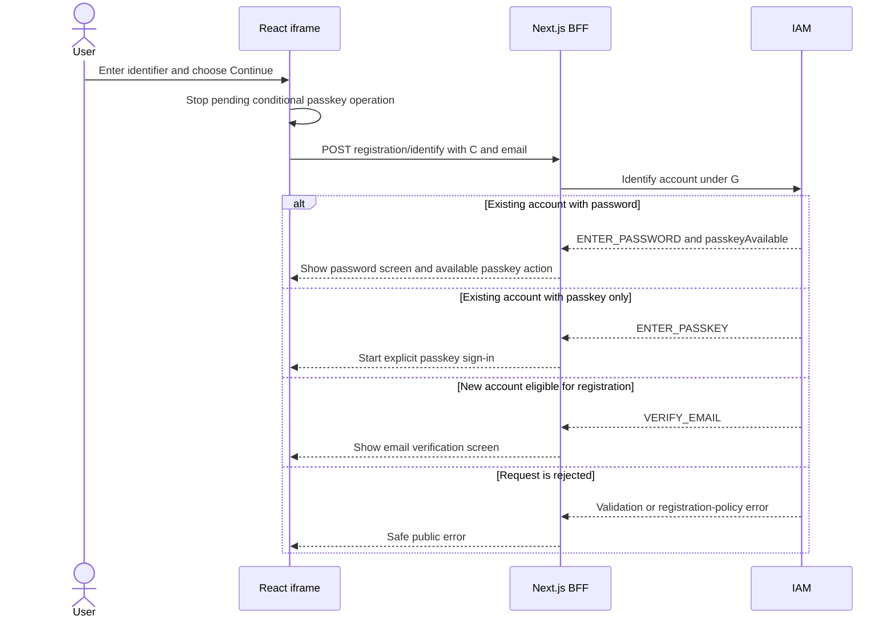

The identifier form accepts an email or phone-shaped value and sends it in the
`email` field of the identification request. IAM determines which identifiers it
supports and requires an email address for new account creation. Existing-user
identification remains available when the client's registration policy is disabled.

Trace the identifier callback in
[AuthExperience](../src/features/authentication-flow/auth-experience.tsx) into
[handleRegistrationAction](../src/server/auth/registration.ts). The latter shares
server-side logic across explicit registration route files.

## 4. Sign in with password and OTP

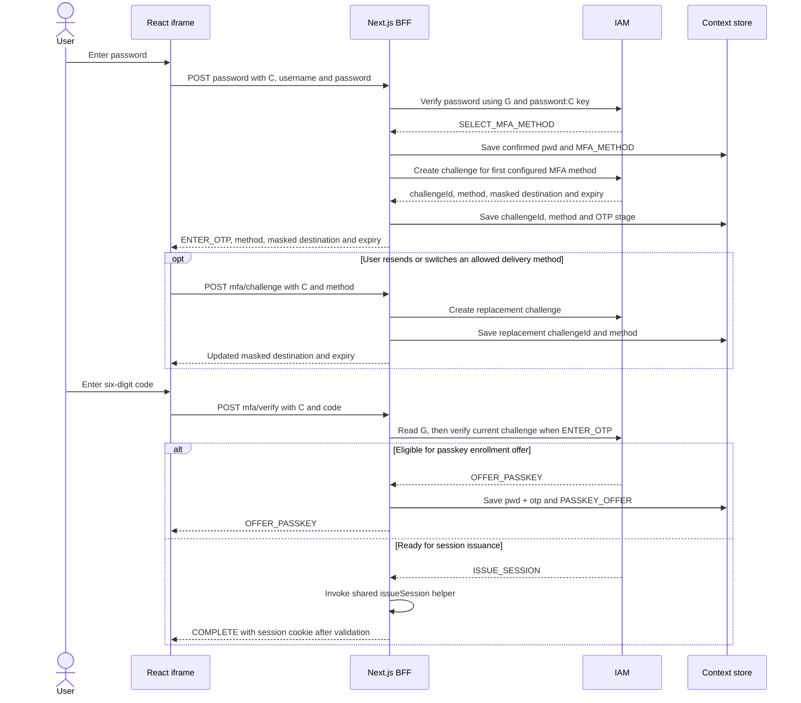

The [password route](../src/app/api/auth/password/route.ts) validates request shape
and the configured method, then asks IAM to verify the password. It saves
`MFA_METHOD` before creating the challenge, so a retry from that stage can finish
challenge creation. The first configured MFA method is selected automatically.
React receives the masked destination and expiry. The challenge ID stays in the
server context.

The [challenge route](../src/app/api/auth/mfa/challenge/route.ts) handles resend and
switching between permitted email/SMS methods. The UI shows a 28-second resend
countdown. IAM owns resend acceptance, code expiry, attempt limits, and code
verification. A successful replacement becomes the BFF's current challenge.

The [MFA verification route](../src/app/api/auth/mfa/verify/route.ts) reads the
current IAM context before submitting verification. It sends `offerPasskey: true`
when the client allows passkeys. IAM decides account eligibility. A repeated MFA
request when the BFF already reached `PASSKEY_OFFER` returns the offer again.
Incorrect credentials leave the user on the relevant input screen with a safe
error from [http.ts](../src/server/http.ts).

## 5. Sign in with an existing passkey

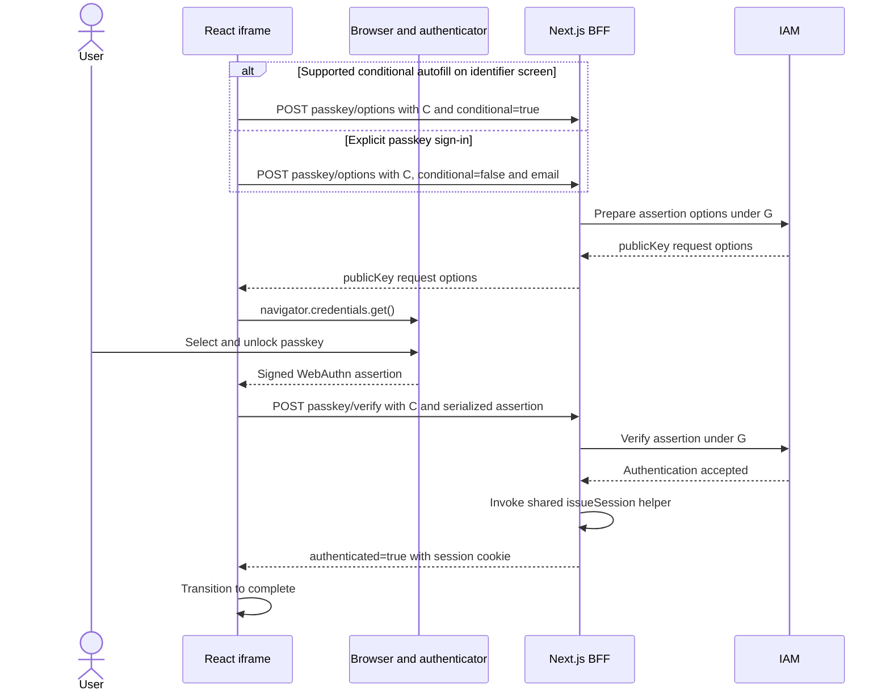

[signInWithPasskey](../src/features/passkeys/login.ts) converts base64url challenge
and credential IDs into the binary values expected by WebAuthn, requests a
credential, and serializes the assertion for the BFF. IAM verifies that response.

The controller starts conditional mediation on the identifier screen where
supported and stops it before a typed identifier is submitted. A passkey-only
account starts explicit sign-in after identification. An account with both methods
can choose Sign in with a passkey from the password screen. The passkey options
and verification routes both require BFF stage `PASSWORD` and a policy permitting
`PASSKEY`. Session assurance accepts `fido` with `uv` or `otp`.

Passkeys use the browser's native prompt. The iframe must delegate
`publickey-credentials-get` and `publickey-credentials-create`. The environment
must support WebAuthn with the matching RP ID and origin. The browser helper
reports cancellation or timeout so the user can try again.

## 6. Create an account

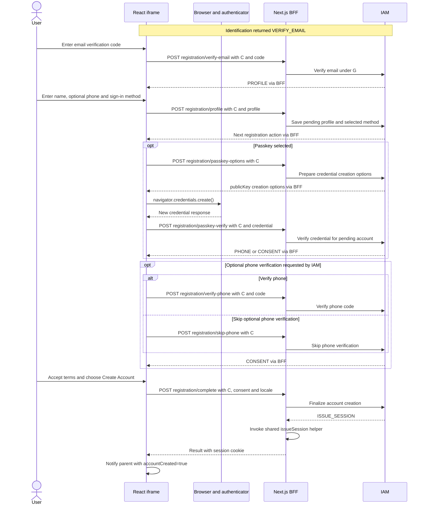

Read [RegistrationExperience](../src/features/registration/components/registration-experience.tsx)
alongside the operation table in [registration.ts](../src/server/auth/registration.ts).
Passkey is selected by default and marked Recommended when allowed by policy.
Choosing password sends the new password with the profile request for IAM to apply
its policy. Profile fields include `firstName`, `lastName`, `phone`, and
`signInMethod`. Consent fields are `termsAccepted`, `marketing`, `rewards`, and
`locale`.

Email/phone code resends call `/api/auth/registration/resend`. The BFF allows that
operation in `REG_EMAIL` and `REG_PHONE`. Each subsequent registration operation
requires `registrationEnabled`, an allowed stage, and permitted request fields.
IAM's next actions map to BFF stages as follows.

| IAM next action | BFF stage | Next operation |
| --- | --- | --- |
| `VERIFY_EMAIL` | `REG_EMAIL` | Verify email or resend |
| `PROFILE` | `REG_PROFILE` | Submit name and chosen credential method |
| `PASSKEY` | `REG_PASSKEY` | Request and verify passkey creation |
| `PHONE` | `REG_PHONE` | Verify, resend, or skip phone verification |
| `CONSENT` | `REG_CONSENT` | Submit account completion |

The BFF calls `issueSession()` after IAM accepts completion. React sends
`IAM_AUTH_COMPLETE` with `accountCreated: true` after that browser request succeeds.

## 7. Add a passkey after password and OTP

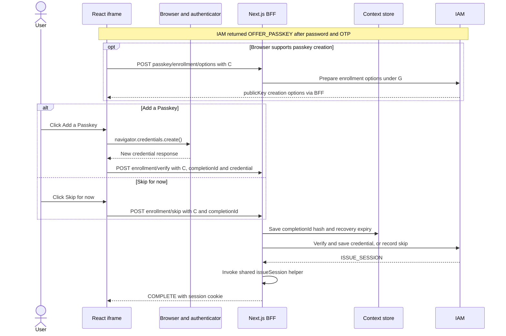

[PasskeyOfferStep](../src/features/passkeys/components/passkey-offer-step.tsx)
prepares public options while the offer is visible, so the Add click can invoke
the native prompt immediately. Its `finish()` function generates a fresh UUID
`completionId` for either choice. The BFF keeps a SHA-256 hash of that ID before
submitting the choice to IAM. The BFF removes `completionId` before forwarding the
enrollment payload.

The [enrollment handler](../src/server/auth/passkey-enrollment.ts) accepts regular
options, verify, and skip operations only in `PASSKEY_OFFER`. IAM must confirm
`OFFER_PASSKEY` before preparing options or accepting a choice. After the choice,
it must confirm `ISSUE_SESSION`. This sign-in retains `pwd` and `otp` assurance,
including when enrollment succeeds. The new passkey is available for later login.

## 8. Deliver the session and notify the host

Every successful login or registration path reaches the shared
[issueSession helper](../src/server/auth/session-issuance.ts).

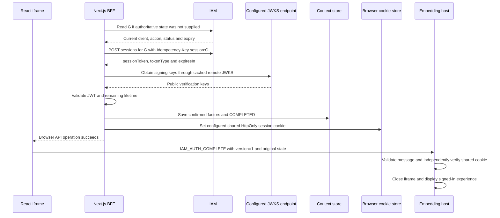

The helper verifies the IAM context identity, client ID, expected action, and
expiry before requesting a session. The JWT must have a valid `RS256` signature,
configured issuer, matching client audience, and required `exp` and `sub` claims.
It also requires `token_use: session` and either password plus OTP or passkey plus
user verification/OTP. Cookie lifetime is bounded by both `expiresIn` and the
JWT's remaining lifetime.

[session-cookie.ts](../src/server/auth/session-cookie.ts) writes the cookie using
the [session settings](../src/server/security/session-settings.ts). The cookie is
HttpOnly, uses path `/`, is Secure in production, and uses configured SameSite.
`SESSION_COOKIE_DOMAIN=example.com` allows delivery to compatible subdomains.
The MFE and the registered parent must be compatible with that domain.

The message carries `type`, `version`, and `state`, with `accountCreated: true`
for registration. A ResizeObserver emits `IAM_AUTH_RESIZE` with the same
correlation fields and the card height. The host checks each message's exact
origin, source iframe, version, and pending state. The completion notification
triggers a session check before the authenticated experience appears.

The BFF also exposes [GET /api/auth/session](../src/app/api/auth/session/route.ts)
with `clientId` for session inspection on its own origin. It verifies the cookie's
JWT and returns `{ authenticated: true, user, amr }`, or `401` with
`{ authenticated: false }`. An embedding host can validate the shared cookie in
its own backend. This keeps session recognition on page reload and subsequent
Sign in clicks independent of the iframe's lifetime.

## 9. Recover a lost enrollment completion response

IAM may save the passkey and issue a session before the response carrying
`Set-Cookie` reaches the browser. The BFF context can already be `COMPLETED` while
the browser still has no session cookie. The enrollment resume operation handles
that delivery failure.

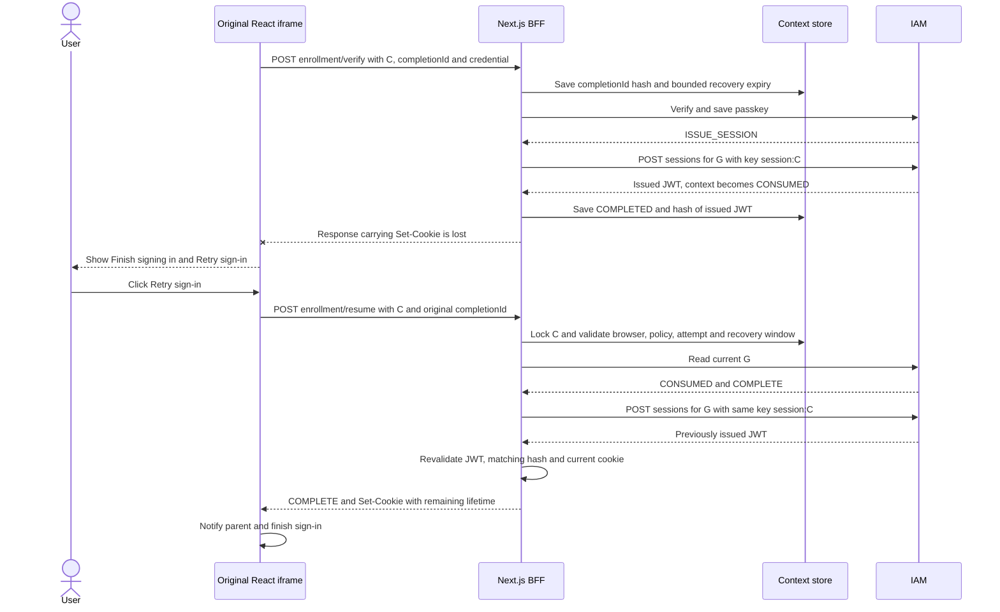

Recovery uses the original attempt and browser. `completionId` proves continuity
with the recorded enrollment choice. `session:${context.id}` identifies the session
operation to IAM. The BFF relies on IAM returning the existing session for that
attempt and idempotency key. The test fixture implements that contract by caching
the session response.

The React `finish()` handler retains `completionId` after a network error, an
ambiguous server error, or `SESSION_COMPLETION_PENDING`. A regular client rejection
returns an error on the enrollment choice. Clicking Retry posts only `contextId`
and `completionId` to `/api/auth/passkey/enrollment/resume`, with browser cookies
and the CSRF header.

`recoverPasskeySession()` runs origin and CSRF checks, then uses `withContext()`
for stage, browser binding, expiry, registered policy, and locking. It permits
`PASSKEY_OFFER` and `COMPLETED`, checks the timing-safe completion hash match and
recovery expiry, and asks IAM for its current state.

| IAM state at retry | Outcome |
| --- | --- |
| `OFFER_PASSKEY` | Return `SESSION_COMPLETION_NOT_READY` and let the user choose Add or Skip again |
| `ISSUE_SESSION` while BFF is `PASSKEY_OFFER` | Finish issuing the first session using the stable session key |
| `CONSUMED` with `COMPLETE` | Request the existing session and deliver its cookie again |
| Invalid identity, action, expiry, or completed BFF context without consumed IAM context | Reject the recovery request |

When the BFF already saved `COMPLETED`, recovery requires its stored session hash
to match the returned token. A different current session cookie causes
`SESSION_ALREADY_PRESENT`. The saved hash contains no recoverable JWT value.

Recovery expires at the earlier of the original context expiry and 60 seconds
after the BFF records the choice. It is available while the original iframe keeps
the ID in React memory. Closing or reloading that iframe loses the recovery ID.
Expired recovery directs the user to close the attempt and start again. Close
sign-in on this screen dismisses the iframe through `IAM_AUTH_CANCELLED` because
IAM may already have completed the attempt.

The resume UI covers the post-OTP enrollment choices. Password/OTP completion
without the offer, passkey login, and new-account completion use their existing
session paths. Their callers do not create this enrollment recovery record.

## 10. Cancel an unfinished attempt or log out

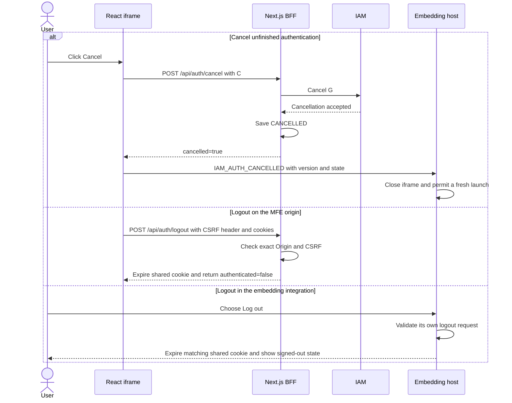

The [cancel route](../src/app/api/auth/cancel/route.ts) allows unfinished login,
offer, and registration stages. After IAM accepts cancellation, the BFF records
`CANCELLED`. A fresh launch needs fresh state. Cancellation preserves any existing
session cookie.

The [logout route](../src/app/api/auth/logout/route.ts) requires origin and CSRF
checks and clears the cookie without requiring a live authentication context.
The cookie deletion uses the same name, domain, and path as creation. The embedding
integration may offer its own logout endpoint with equivalent cookie scope and
request protection. Current logout removes the browser cookie. IAM-side session
revocation is outside this implementation.

## 11. How the browser tests exercise the flow

Tests under [tests/e2e](../tests/e2e) start the MFE with local embedding and REST
fixtures. The fixtures live in this repository and require no other source
checkout. The [launch helper](../tests/e2e/fixtures/chat-launch.ts) observes network
requests and asserts zero requests to the MFE before Sign in is clicked. Server
readiness checks use TCP to avoid preloading an MFE HTTP route.

| Tests | Behavior verified |
| --- | --- |
| [authentication.spec.ts](../tests/e2e/authentication.spec.ts) | Inline password/MFA sign-in, reload/session recognition, logout, invalid OTP, cancellation, framing, and direct navigation |
| [recovery.spec.ts](../tests/e2e/recovery.spec.ts) | Incorrect-password recovery, resend countdown, old-code rejection, and expired-code recovery |
| [registration.spec.ts](../tests/e2e/registration.spec.ts) | Password registration followed by password/MFA login |
| [passkey.spec.ts](../tests/e2e/passkey.spec.ts) | Passkey registration/login, altered assertion rejection, Add and Skip, and dropped-response recovery |
| [context-security.spec.ts](../tests/e2e/context-security.spec.ts) | Origin/CSRF, browser binding, launch-state reuse, premature MFA, and unknown, expired, cancelled, or completed contexts |

The dropped-response test forwards the original browser request to the actual
BFF using Node `fetch`. Node receives the successful response and `Set-Cookie`
without installing that cookie in Chromium. The interceptor drains the response
and aborts the browser request so React sees an interruption.

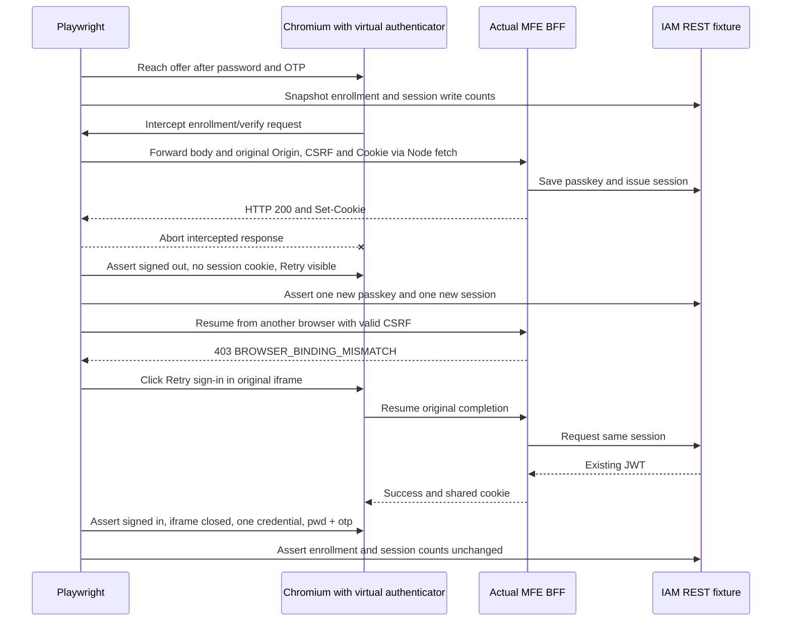

The assertions establish that IAM committed before the response was dropped and
that recovery finishes without a second enrollment or session issuance. The
virtual authenticator count checks the browser's stored credential as well. This
fault-injection case covers the response lost after session issuance. It uses
controlled REST behavior and Chromium's virtual authenticator. The fixture suite
uses loopback origins and in-memory context storage. HTTPS parent-domain cookie
behavior, native device prompts, and Redis deployment behavior require their
corresponding environments.

Run the suite from this repository using `pnpm test:e2e`. For a visible browser,
use `pnpm test:e2e:headed`. Run just the response-loss case with
`pnpm test:e2e passkey.spec.ts -g 'recovers a dropped enrollment response'`.
`pnpm test:e2e:manual` lets a developer drive the experience using native browser
prompts. See the [README browser-test instructions](../README.md#browser-tests)
for fixture credentials and environment requirements.

## Reference for debugging

| Observation | Code or data to inspect |
| --- | --- |
| Launch fails or framing is blocked | Registered configuration, response CSP, and handshake origin/source/version/state |
| POST is rejected | Exact `IDENTITY_ORIGIN`, CSRF cookie/header pair, browser-binding cookie, and `withContext()` checks |
| Screen is out of step | React machine state, BFF context stage, and IAM's authoritative next action |
| Attempt cannot continue | Absolute context expiry, policy version, cancellation/completion, or `CONTEXT_BUSY` |
| Session issuance fails | IAM context confirmation, audience/issuer/JWKS configuration, assurance, and expiry |
| Session is absent after completion | Actual cookie delivery and configured name/domain/path/SameSite/Secure settings |
| Recovery is rejected | Original browser, completion hash/expiry, IAM state, saved JWT hash, and existing session cookie |

Use safe error codes and non-sensitive state when investigating. Keep passwords,
OTPs, raw credential payloads, subscriber secrets, service tokens, and session JWTs
out of logs. The [request-security helpers](../src/server/security/request-security.ts)
and [safe error mapping](../src/server/http.ts) centralize these request boundaries.
